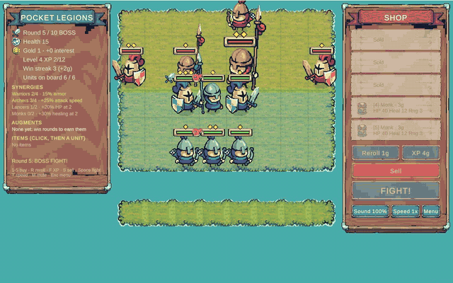

# Auto Battler

A small grid-based auto battler made in Unity 6 (URP 2D) for the browser. Spend gold in the shop, place units on
your half of the board, then watch them fight a wave of enemies on their own. Buy three copies of the same unit and
they merge into a stronger, starred version. Survive all 10 rounds to win.


<!-- TODO: record a GIF of a round and save it as docs/gameplay.gif -->

**Play it on itch.io:** _coming soon_ <!-- TODO: replace with https://<user>.itch.io/auto-battler -->

## How to play

| Phase  | What happens |
| ------ | ------------ |
| Shop   | You get gold every round (5 + 1 per 10 gold banked, max +3, +1 for a win). Buy units, reroll the shop, sell units, and arrange your board. |
| Battle | Units act on their own: fighters walk to the nearest enemy and attack once it's in range, archers shoot arrows that have to fly to their target, and monks heal whichever ally is most hurt. |
| Result | Losing costs 2 health plus 1 for each enemy still standing. You lose at 0 health and win by clearing round 10. |

| Unit | Cost | Role |
| ---- | ---- | ---- |
| **Warrior** | 1g | Sturdy melee fighter |
| **Archer** | 1g | Fires arrows from 3 cells away |
| **Lancer** | 3g | Tank with a heavy lance thrust (in shops from round 3) |
| **Monk** | 3g | Heals the ally with the lowest HP fraction, never attacks (in shops from round 3) |

You play the blue faction and fight the red one. You can field 3 units in round 1, plus one more each round after
that (up to 8).

## Controls

| Input | Action |
| ----- | ------ |
| Left-click a unit, then a cell/bench slot | Move it there (swaps if the target is occupied) |
| Right-click / `Esc` | Cancel selection |
| `1`–`5` or click a shop card | Buy that unit |
| `R` | Reroll the shop (1 gold) |
| `S` | Sell the selected unit |
| `Space` | Start the battle |

## Architecture

```
Assets/
  Scripts/
    Core/   AutoBattler.Core  – pure C# game rules, no UnityEngine reference (noEngineReferences)
    Game/   AutoBattler.Game  – MonoBehaviours: bootstrap, rendering, HUD, input
  Tests/
    EditMode/ AutoBattler.Tests.EditMode – NUnit tests against Core
```

- **Core** holds all the rules. `GameSession` runs the economy, the shop, bench and board slots, merging, and the
  round loop. `BattleSimulator` is a deterministic battle running at 10 ticks per second. It returns `BattleEvent`s
  (move, action start, projectile launch, damage, heal, death). Each action takes effect `ImpactTicks` after it
  starts, and that number is the impact frame of the unit's 10 fps attack animation, so hits land on the right frame.
  Arrows are simulated projectiles: if their target dies while they are in flight, they miss. `EnemyWaves` and
  `Shop` use an injected `IRandom` (`SeededRandom`), so a seed always replays the same run.
- **Game** only draws and forwards input. `GameBootstrap` runs from
  `[RuntimeInitializeOnLoadMethod(AfterSceneLoad)]` and builds everything in code: camera, global 2D light,
  EventSystem, a UI Toolkit HUD (`Hud`), and the `GameController`, which plays battle events back at the tick rate.
  Nothing needs to be wired up in the editor.
- **Art** (`Art`) loads the Tiny Swords sheets from `Assets/Resources/Art/TinySwords` and slices them at runtime.
  Unit sheets are strips of square frames. The pack's UI pieces come with gaps between them, so they are stitched
  into 9-slice textures, then used for the wood panels, paper shop cards, ribbons, buttons, and the unit HP bars.
  `SpriteAnimator` plays the strips at 10 fps. The editor-only `TinySwordsImporter` (an `AssetPostprocessor`) imports
  the pack with Point filtering, no compression, and 64 pixels per unit, so one terrain tile is one board cell.
- Input goes through the Input System package (`Mouse.current` / `Keyboard.current`, and `InputSystemUIInputModule`
  for the UI).

## Credits

Art: [Tiny Swords](https://pixelfrog-assets.itch.io/tiny-swords) by **Pixel Frog**. Only the files this game uses are
included, under `Assets/Resources/Art/TinySwords`. Check the pack's itch.io page for its license terms before you
redistribute them.

## Running

Open the project in **Unity 6000.6.5f1** and press Play in any scene; the bootstrap builds the game for you.

## Tests

In the editor: **Window → General → Test Runner → EditMode → Run All**.

From the command line (close the editor first):

```sh
/Applications/Unity/Hub/Editor/6000.6.5f1/Unity.app/Contents/MacOS/Unity \
  -batchmode -nographics -projectPath . \
  -runTests -testPlatform EditMode -testResults results.xml
```

## CI

`.github/workflows/ci.yml` uses [GameCI](https://game.ci) to run the EditMode tests and then build WebGL, uploading
the build as an artifact. Before it can run, add these repository secrets: `UNITY_LICENSE` (the contents of your
`.ulf` file), `UNITY_EMAIL`, and `UNITY_PASSWORD`. See GameCI's [activation guide](https://game.ci/docs/github/activation).
